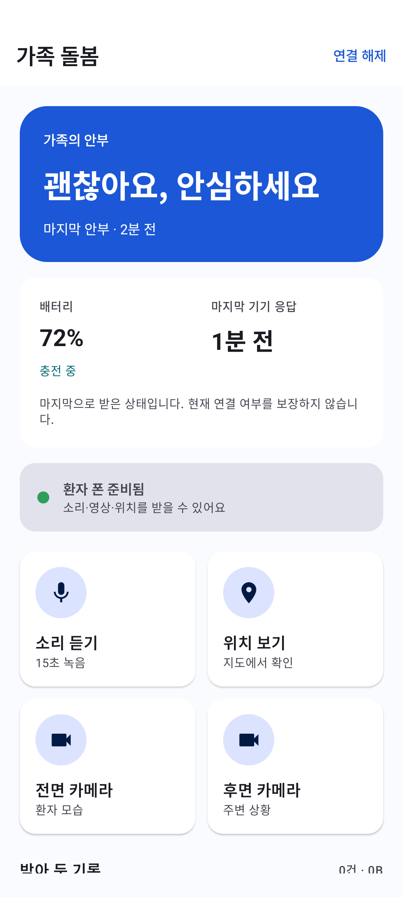
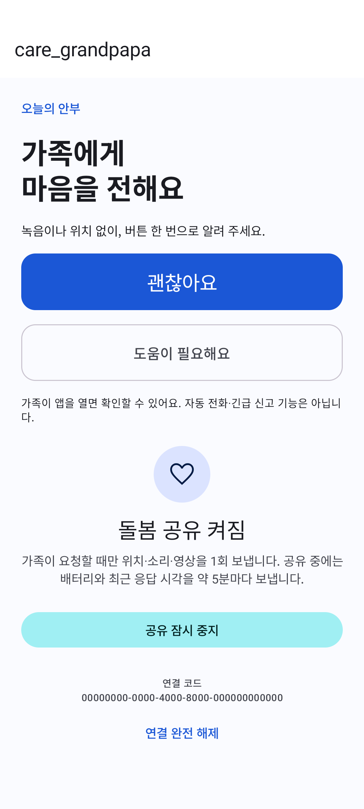
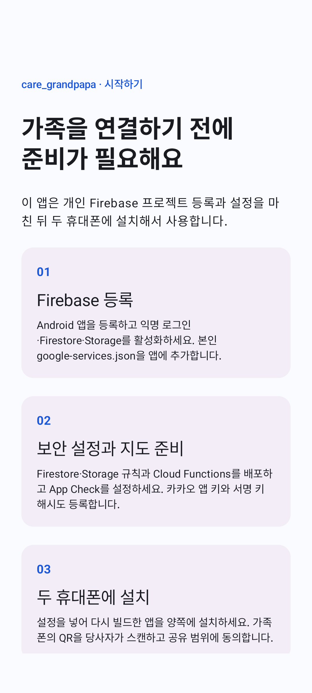

# care_grandpapa

치매 환자를 돌보는 간병인을 위한 Android 돌봄 앱입니다. 간병인으로서 환자가 길을 잃거나 사라지는 상황에 대비하고, 위치와 주변 상태를 빠르게 확인할 수 있도록 만들었습니다.

간병인과 환자의 휴대폰을 연결해 위치, 짧은 음성·영상, 안부와 기기 상태를 확인합니다.

## 화면

| 간병인 | 환자 | 시작 안내 |
|---|---|---|
|  |  |  |

## 주요 기능

- **위치 확인** — 환자의 위치를 지도에서 확인하고 새로고침합니다.
- **주변 상태 확인** — 15초 음성 또는 전면·후면 카메라 영상을 요청합니다.
- **안부 전달** — 환자가 ‘괜찮아요’ 또는 ‘도움이 필요해요’를 보냅니다.
- **기기 상태** — 배터리 잔량, 충전 여부, 마지막 기기 응답 시간을 확인합니다.
- **기록 보관** — 전달받은 음성과 영상을 간병인의 휴대폰에서 다시 재생합니다.
- **기기 연결** — QR 또는 연결 코드로 두 휴대폰을 연결합니다.

## 시작하기

Android 7.0(API 24) 이상 휴대폰 두 대가 필요합니다. 서비스 운영자는 Firebase와 카카오 개발자 계정을 등록하고 아래 설정을 마친 뒤 앱을 설치해야 합니다.

1. **Firebase 등록**: Android 패키지 `com.caregrandpapa`를 등록하고 익명 인증, Firestore, Storage, FCM을 설정합니다. 내려받은 `google-services.json`을 `app/`에 넣습니다.
2. **지도 등록**: 카카오에 Android 패키지와 서명 키 해시를 등록합니다. `secrets.properties.example`을 `secrets.properties`로 복사하고 `KAKAO_NATIVE_APP_KEY`를 입력합니다.
3. **서버 설정**: `.firebaserc.example`을 `.firebaserc`로 복사해 프로젝트 ID를 입력합니다. Firebase CLI 로그인 후 `functions/`에서 `npm ci`를 실행하고, 루트에서 `firebase deploy --only firestore:rules,storage,functions`로 배포합니다. App Check도 등록하고 적용합니다.
4. **설치**: Android Studio에서 프로젝트를 열고 두 휴대폰에 빌드·설치합니다. 배포용 APK는 본인의 서명 키로 빌드합니다.
5. **연결**: 간병인 휴대폰에서 역할을 선택하고 QR을 표시합니다. 환자 휴대폰에서 QR을 스캔한 뒤 공유 동의와 필요한 권한 설정을 완료합니다.

## 사용 안내

간병인 홈에서 위치·소리·카메라를 선택하면 연결된 휴대폰에 요청을 보냅니다. 환자 홈에서는 안부를 보내고 공유를 중지하거나 연결을 해제할 수 있습니다.

안부는 간병인이 앱을 열어 확인하며 자동 신고나 긴급 알림으로 전송되지 않습니다. 기기 상태는 마지막 수신값으로 표시됩니다. 앱을 강제 종료하거나 휴대폰을 재부팅한 경우 환자 휴대폰에서 앱을 다시 열어 주세요.

## 기술

Kotlin · Jetpack Compose · Material 3 · Firebase · CameraX · Media3 · Kakao Maps
